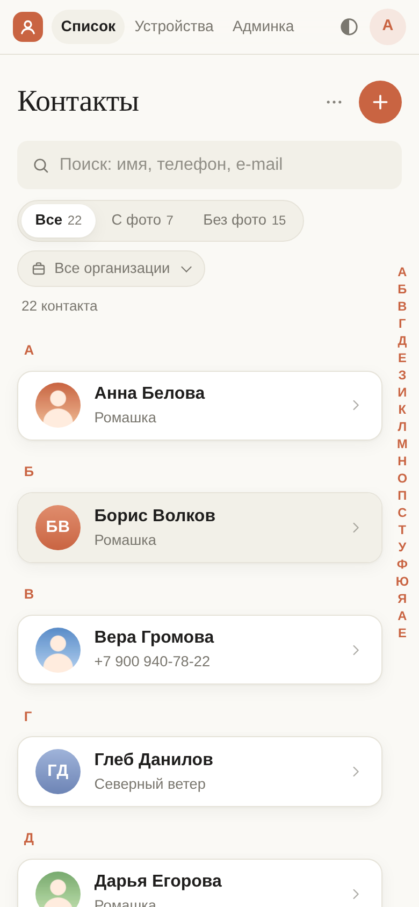
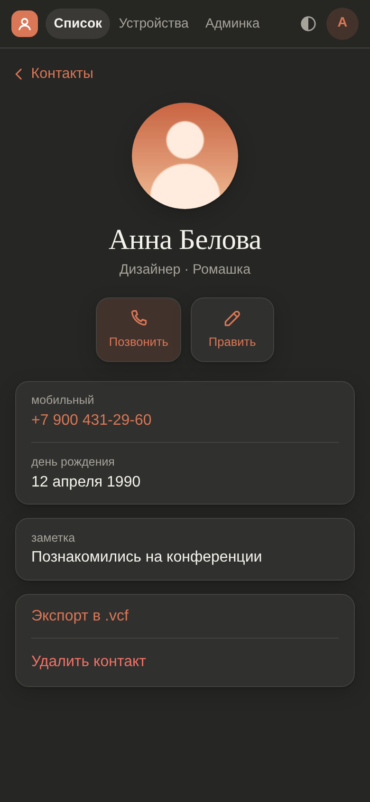
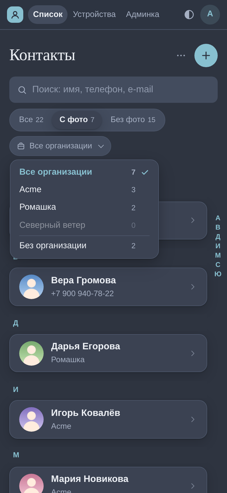
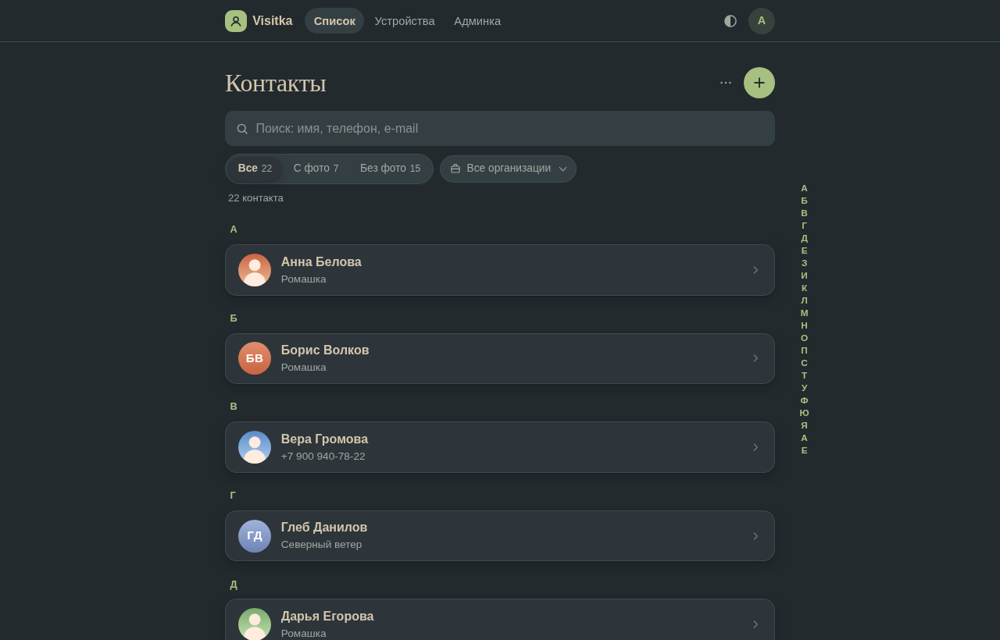

# Visitka — своя адресная книга на CardDAV с удобным веб-интерфейсом

[English](README.md) · **Русский**

[](https://github.com/tanweber/Visitka/actions/workflows/docker.yml)
[](LICENSE)


**Visitka** («визитка» — как vCard) — самостоятельно размещаемая (self-hosted) адресная книга для семьи или небольшой команды.
Телефоны синхронизируют контакты по **CardDAV** (DAVx5 на Android, встроенные «Контакты»
на iPhone и Mac), а быстрый лаконичный **веб-интерфейс** позволяет искать и править их
из любого браузера. Всё запускается одной командой `docker compose up -d`.

В основе — [Radicale](https://radicale.org/) (CardDAV-сервер) и небольшое приложение
на FastAPI: пользователи, пароли устройств и веб-интерфейс. Без облаков и слежки —
ваши vCard остаются на вашем сервере.

<p align="center">
  
  
  
</p>

<p align="center">
  
</p>

## Возможности

- **Синхронизация по CardDAV** с Android (DAVx5), iPhone, iPad, macOS, Thunderbird.
- **Несколько пользователей**: у каждого своя адресная книга, администратор управляет учётками.
- **Пароли устройств**: у каждого телефона свой пароль, его можно отозвать; он не совпадает с паролем входа на сайт.
- **Мгновенный поиск** по имени, организации, e-mail и номеру в любом виде (`8 900…` = `+7 900…`).
- **Алфавит сбоку списка**, как в телефоне: нажмите на букву или ведите пальцем.
- **Фильтры**: с фото / без фото, по организации — вместе с поиском.
- **Фото контактов** с обрезкой и масштабом; хранятся в самой vCard (3.0 и 4.0).
- **Дни рождения** в едином формате, показываются как «12 апреля 1990», можно без года.
- **Импорт и экспорт** `.vcf` с прогрессом; совпадения по UID — пропустить или заменить, без дублей.
- **Русский и английский** интерфейс: выбирается по языку браузера или в меню.
- **Темы**: как в системе, светлая, тёмная, Nord, Forest.
- **Сделано для телефона**: лёгкий чистый дизайн в духе Apple и claude.ai.
- **Безопасность по умолчанию**: argon2, защита от CSRF, строгий CSP, контейнеры только
  на чтение, ограничение попыток входа, обязательная смена пароля при первом входе.

## Быстрый старт

Готовые образы для amd64 и arm64 (Raspberry Pi) лежат в GitHub Container Registry,
поэтому нужен всего один файл:

```bash
mkdir visitka && cd visitka
curl -fsSLO https://raw.githubusercontent.com/tanweber/Visitka/main/compose.yaml
docker compose up -d
```

Откройте `http://<сервер>:8080` и войдите как **admin / admin**. Приложение сразу попросит
задать новый пароль — до этого остальные разделы недоступны.

Затем в разделе **«Устройства»** создайте пароль устройства и подключите телефон.

Для постоянной работы поставьте сервис за обратный прокси с TLS и задайте `PUBLIC_URL`
(см. ниже). Без `.env` всё работает на безопасных значениях по умолчанию.

## Настройка

Скопируйте `.env.example` в `.env` и поменяйте нужное. Все параметры необязательны.

| Переменная | По умолчанию | Что задаёт |
|---|---|---|
| `PUBLIC_URL` | адрес из запроса | Внешний адрес — показывается в интерфейсе и инструкции для телефонов, например `https://contacts.example.com` |
| `ADMIN_USERNAME` | `admin` | Первый администратор, создаётся при пустой базе |
| `ADMIN_PASSWORD` | `admin` | Его пароль; пароль по умолчанию нужно сменить при первом входе |
| `SECRET_KEY` | генерируется | Ключ подписи сессий; создаётся один раз и хранится в томе `app_data` |
| `CADDY_HTTP_PORT` | `8080` | Порт на хосте |
| `COOKIE_SECURE` | `auto` | Secure-cookie; `auto` включает их, если `PUBLIC_URL` начинается с `https://` |
| `DEFAULT_LANG` | `auto` | Язык интерфейса: `auto` (по браузеру), `ru` или `en`; переключается и в меню |
| `ADDRESSBOOK_NAME` | `Контакты` / `Contacts` | Имя адресной книги на телефонах, задаётся при создании пользователя |
| `TZ` | `Europe/Moscow` | Часовой пояс интерфейса и логов (в базе время в UTC) |
| `CONTACTS_SUBNET` | `10.77.0.0/24` | Внутренняя подсеть Docker; смените, если пересекается с вашей |
| `VISITKA_VERSION` | `latest` | Тег образов: `latest`, номер релиза вроде `1.0` или `edge` |

Изменения применяются командой `docker compose up -d`. Обновление: `docker compose pull && docker compose up -d`.

## Подключение телефонов

Адрес сервера есть на странице **«Устройства»** — с кнопкой копирования.

**Android (DAVx5)**: «+» → «Вход по URL и имени пользователя» → базовый URL
`https://contacts.example.com`, имя пользователя и **пароль устройства** (не пароль сайта) →
включите адресную книгу «Контакты».

**iPhone / iPad**: Настройки → Контакты → Учётные записи → Новая учётная запись → Другое →
«Учётная запись CardDAV» → сервер `contacts.example.com`, имя пользователя, пароль устройства.

**macOS**: Контакты → Настройки → Учётные записи → «+» → Другая учётная запись контактов → CardDAV.

## Обратный прокси и TLS

Стек слушает обычный HTTP (`CADDY_HTTP_PORT`). TLS поднимите перед ним — Nginx Proxy Manager,
Traefik, Caddy или nginx, — проксируйте всё на `http://<сервер>:8080` и задайте
`PUBLIC_URL=https://ваш.домен`. Автообнаружение CardDAV (`/.well-known/carddav`) стек
обрабатывает сам.

## Устройство

```
телефон / браузер ──TLS──▶ ваш обратный прокси ──▶ caddy :8080
                                                    ├─ /carddav/* ─ forward_auth ─▶ app  (проверка пароля устройства)
                                                    │                └──────────▶ radicale (X-Remote-User)
                                                    └─ /*  ───────────────────────▶ app  (веб-интерфейс, FastAPI)
```

- **caddy** — маршрутизация, `forward_auth` для CardDAV, защитные заголовки; удаляет
  `X-Remote-User`, присланный клиентом (`caddy:2.11.7` со встроенным Caddyfile).
- **radicale** — хранилище CardDAV (`python:3.12-slim` + `radicale==3.8.3`), снаружи недоступен.
- **app** — FastAPI + Jinja2 + SQLite: пользователи, пароли устройств, веб-интерфейс.

## Сборка из исходников

```bash
git clone https://github.com/tanweber/Visitka.git visitka && cd visitka
docker compose -f compose.yaml -f compose.build.yaml up -d --build
```

Чтобы всегда собирать у себя, добавьте в `.env` строку `COMPOSE_FILE=compose.yaml:compose.build.yaml`.

## Резервные копии и обслуживание

```bash
scripts/backup.sh          # архив тома Radicale + копия SQLite в ./backups
scripts/smoke.sh           # проверки работающего стека
docker compose run --rm app pytest -q   # тесты
```

## Безопасность

- Контейнеры только на чтение, `no-new-privileges`, все capabilities сброшены.
- Пароли сайта и устройств хранятся в argon2; неудачные попытки входа ограничены.
- Смена пароля завершает другие сессии; отзыв пароля устройства действует сразу.
- Секреты получает только контейнер `app`.

## Лицензия

[MIT](LICENSE)

---

**Ключевые слова:** свой сервер контактов, CardDAV, веб-интерфейс для Radicale, адресная книга,
DAVx5, синхронизация контактов iPhone и Android, vCard, Docker Compose, замена Google Контактов.
